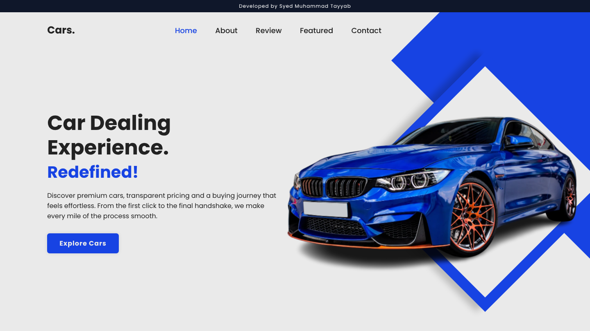
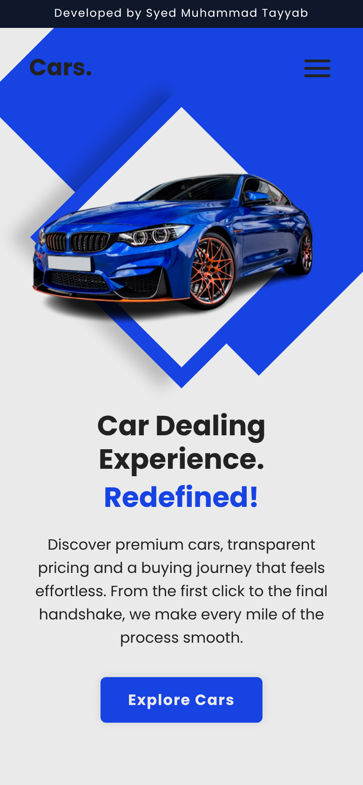
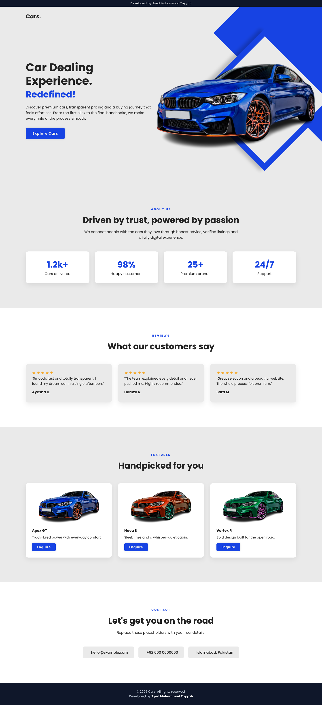
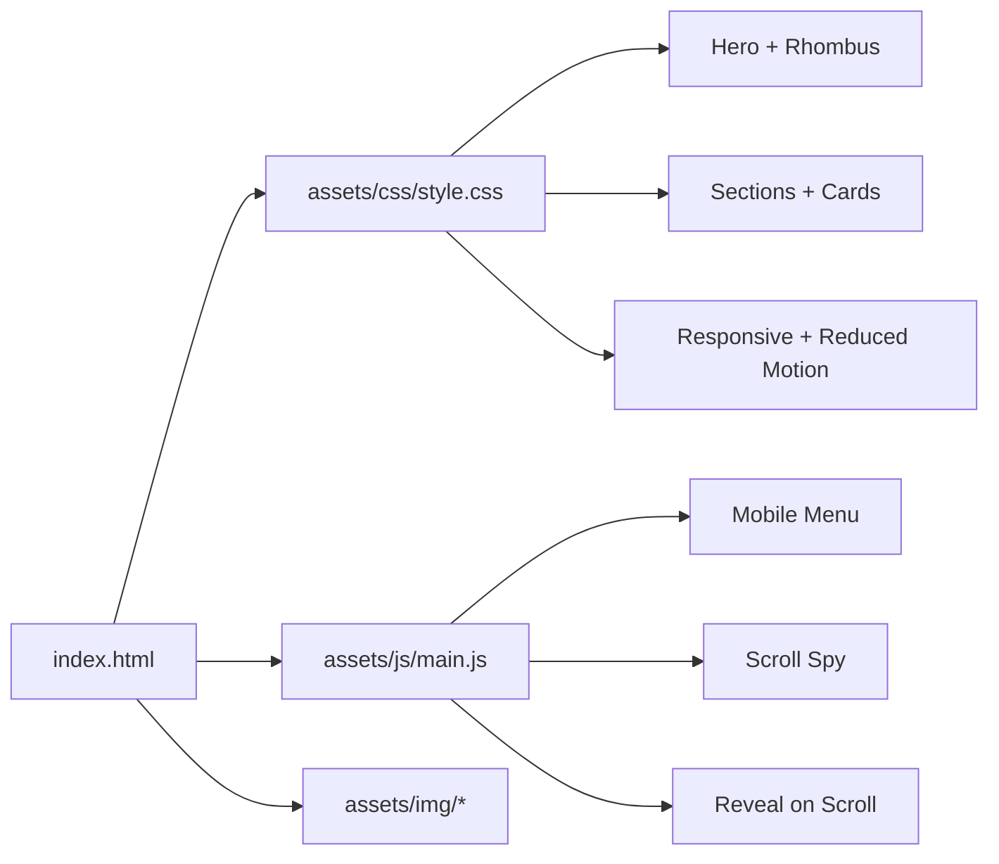

<div align="center">

<!-- ===================== HEADER ===================== -->


<h3>🚘 Developed by Syed Muhammad Tayyab 🚘</h3>

<a href="https://github.com/Syed-Muhammad-Tayyab/Car-Website-Landing-Page">
  
</a>

<br/>

[](https://syed-muhammad-tayyab.github.io/Car-Website-Landing-Page/)
[](https://github.com/Syed-Muhammad-Tayyab/Car-Website-Landing-Page)
[](LICENSE)


<br/>

**[✨ Overview](#-overview) · [🎬 Preview](#-preview) · [🚀 Features](#-features) · [🧰 Tech Stack](#-tech-stack) · [📁 Structure](#-project-structure) · [⚡ Quick Start](#-quick-start) · [🎨 Customize](#-customization) · [🌍 Deploy](#-deployment) · [🗺️ Roadmap](#%EF%B8%8F-roadmap) · [🤝 Contribute](#-contributing) · [📜 License](#-license)**


</div>

## ✨ Overview

**Cars.** is a sleek, animated **car dealing landing page** with a signature **rhombus hero**, staggered entrance animations and a clean blue-and-grey palette. It is built with nothing but **HTML, CSS and a tiny bit of vanilla JavaScript**: no frameworks, no build step, no dependencies. Open `index.html` and it just works. 🏁

> 💡 **Why this project?** It is a perfect example of how far pure CSS keyframes, CSS variables and modern layout (flexbox + grid) can take a landing page, and a great starter template for any dealership, showroom or product site.

<div align="center"></div>

## 🎬 Preview

<div align="center">

### 🖥️ Animated Demo


### 🏠 Hero Section


### 📱 Mobile View &nbsp;&nbsp;|&nbsp;&nbsp; 🧾 Full Page

<table>
  <tr>
    <td align="center"></td>
    <td align="center"></td>
  </tr>
</table>

</div>

<div align="center"></div>

## 🚀 Features

| | Feature | Description |
|:-:|---|---|
| 🎞️ | **Cinematic hero** | Rotated rhombus frame, car fly-in, staggered text and nav animations |
| 📱 | **Fully responsive** | Desktop, tablet and phone layouts with a CSS-only hamburger menu |
| 🧭 | **Smart navigation** | Smooth scrolling and scroll-spy highlighting of the active link |
| 🪄 | **Scroll reveal** | Sections fade and slide in with `IntersectionObserver` |
| 🧱 | **Complete page** | Home, About (stats), Reviews, Featured cars and Contact sections |
| ⚡ | **Optimized assets** | Hero image shrunk from **7.9 MB to 1.3 MB PNG** with a **160 KB WebP** via `<picture>` |
| ♿ | **Accessible** | Semantic HTML, ARIA labels, alt text and `prefers-reduced-motion` support |
| 🎨 | **Easy theming** | Colors live in CSS variables, so rebrand in seconds |
| 🔍 | **SEO ready** | Meta description, theme color, author tag and favicon |
| 🧩 | **Zero dependencies** | Only Google Fonts (Poppins) and Boxicons for icons |

<div align="center"></div>

## 🧰 Tech Stack

<div align="center">


| Layer | Tools |
|---|---|
| 🧱 Markup | HTML5 (semantic, `<picture>`, ARIA) |
| 🎨 Styling | CSS3 (variables, flexbox, grid, keyframes, media queries) |
| ⚙️ Scripting | Vanilla JavaScript (ES6, `IntersectionObserver`) |
| 🔤 Font | [Poppins](https://fonts.google.com/specimen/Poppins) |
| 🔣 Icons | [Boxicons](https://boxicons.com/) |
| 🚢 Hosting | GitHub Pages with GitHub Actions |

</div>

### 🧬 Page Architecture



<div align="center"></div>

## 📁 Project Structure

```text
Car-Website-Landing-Page/
├── 📄 index.html                  # Page markup
├── 📂 assets/
│   ├── 🎨 css/style.css           # All styles, animations, responsive rules
│   ├── ⚙️ js/main.js              # Menu, scroll-spy, reveal animations
│   ├── 🖼️ img/
│   │   ├── car.webp               # Optimized hero image (160 KB)
│   │   ├── car.png                # PNG fallback (1.3 MB)
│   │   └── favicon.svg            # Site icon
│   └── 📸 readme/                 # Banner, screenshots, demo GIF
├── 📂 .github/
│   ├── workflows/pages.yml        # Auto-deploy to GitHub Pages
│   ├── ISSUE_TEMPLATE/            # Bug report and feature request forms
│   └── PULL_REQUEST_TEMPLATE.md
├── 📝 CHANGELOG.md
├── 🤝 CONTRIBUTING.md
├── 📏 CODE_OF_CONDUCT.md
├── 🔐 SECURITY.md
├── ⚖️ LICENSE
├── .editorconfig
├── .gitattributes
├── .gitignore
└── 📖 README.md
```

<div align="center"></div>

## ⚡ Quick Start

```bash
# 1️⃣ Clone the repository
git clone https://github.com/Syed-Muhammad-Tayyab/Car-Website-Landing-Page.git

# 2️⃣ Enter the project
cd Car-Website-Landing-Page

# 3️⃣ Open it, no build step needed
open index.html        # macOS
start index.html       # Windows
xdg-open index.html    # Linux
```

<details>
<summary><b>🖧 Prefer a local dev server?</b></summary>

```bash
# Python
python -m http.server 5500

# Node
npx serve .

# VS Code → install "Live Server" → right-click index.html → Open with Live Server
```

Then visit **http://localhost:5500** 🎉
</details>

<div align="center"></div>

## 🎨 Customization

Open `assets/css/style.css` and edit the variables at the top:

```css
:root {
    --primary: #1743e3;  /* brand blue */
    --bg:      #eaeaea;  /* page background */
    --text:    #222;     /* text color */
    --card:    #fff;     /* card background */
    --dark:    #0f172a;  /* top bar and footer */
}
```

| I want to… | Edit |
|---|---|
| 🏷️ Change the brand name | `.logo` link and `<title>` in `index.html` |
| 🚗 Swap the hero car | Replace `assets/img/car.webp` and `car.png` with a transparent cutout |
| ✍️ Edit hero copy | `.home-content` in `index.html` |
| 📞 Update contact info | `#contact` section in `index.html` |
| 🔗 Add social links | `.social-media` anchors in `index.html` |
| ⏱️ Adjust animation speed | `animation-delay` values and `@keyframes` in `style.css` |

<details>
<summary><b>📐 Responsive breakpoints</b></summary>

| Breakpoint | Layout |
|---|---|
| `> 991px` | Full desktop hero with side-by-side content and rhombus |
| `≤ 991px` | Stacked hero, hamburger menu, resized rhombus |
| `≤ 520px` | Compact phone layout with smaller type and image |
</details>

<div align="center"></div>

## 🌍 Deployment

This repo ships with a **GitHub Actions workflow** (`.github/workflows/pages.yml`) that publishes the site on every push to `main`.

1. Push the repo to GitHub.
2. Go to **Settings → Pages**.
3. Under **Build and deployment → Source**, choose **GitHub Actions**.
4. Push to `main` and your site goes live at:

```text
https://syed-muhammad-tayyab.github.io/Car-Website-Landing-Page/
```

Also works with **Netlify**, **Vercel** and **Cloudflare Pages**: just drag and drop the folder, no build command needed.

<div align="center"></div>

## 🗺️ Roadmap

- [x] Animated rhombus hero
- [x] Responsive layout with mobile menu
- [x] About, Reviews, Featured and Contact sections
- [x] Optimized WebP images
- [x] GitHub Pages deployment workflow
- [ ] 🌙 Dark mode toggle
- [ ] 🔎 Car filtering and search
- [ ] 📩 Working contact form
- [ ] 🌐 Multi-language support
- [ ] 🖼️ Image gallery and lightbox

<div align="center"></div>

## 🤝 Contributing

Contributions, issues and feature requests are welcome! 🙌

1. 🍴 **Fork** the project
2. 🌿 Create a branch: `git checkout -b feature/amazing-feature`
3. 💾 Commit: `git commit -m "feat: add amazing feature"`
4. 📤 Push: `git push origin feature/amazing-feature`
5. 🔁 Open a **Pull Request**

Please read [CONTRIBUTING.md](CONTRIBUTING.md) and the [Code of Conduct](CODE_OF_CONDUCT.md) first.

## 📜 License

Distributed under the **MIT License**. See [`LICENSE`](LICENSE) for details.

## 🙏 Credits

- 🎨 Original landing page design and base code by **Nishat Mahmud** (MIT License, 2023)
- 🛠️ Repository structure, responsive redesign, extra sections and documentation by **Syed Muhammad Tayyab**
- 🔤 Fonts: [Google Fonts](https://fonts.google.com/) · 🔣 Icons: [Boxicons](https://boxicons.com/)
- 🏷️ Badges: [Shields.io](https://shields.io/) · ⌨️ Typing SVG: [readme-typing-svg](https://github.com/DenverCoder1/readme-typing-svg)

<div align="center"></div>

## 👨‍💻 Author

<div align="center">

<a href="https://github.com/Syed-Muhammad-Tayyab">
  
</a>

### Syed Muhammad Tayyab
*BSCS Student · Information Security · Full-Stack Web Developer*

[](https://github.com/Syed-Muhammad-Tayyab)


### ⭐ Star History

<a href="https://star-history.com/#Syed-Muhammad-Tayyab/Car-Website-Landing-Page&Date">
  
</a>

<br/>

**If this project helped you, please give it a ⭐. It keeps the engine running!** 🏎️💨

<!-- ===================== FOOTER ===================== -->


<sub>© 2026 Cars. · Developed by <b>Syed Muhammad Tayyab</b> · Released under the MIT License</sub>

</div>
